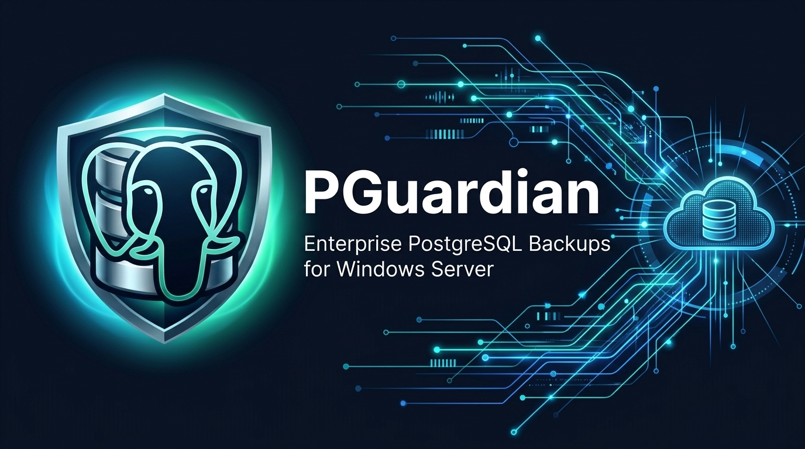

<div align="center">



# PGuardian

**Gestor Empresarial de Copias de Seguridad de PostgreSQL para Windows Server y Entornos RDP (Terminal Server)**  
*Enterprise-Grade PostgreSQL Backup & Google Drive Sync Manager for Windows Server & Multi-Session RDP*

[](https://github.com/nico9julio/PGuardian/releases)
[](https://go.dev/)
[](https://wails.io/)
[](https://github.com/nico9julio/PGuardian/releases)
[](LICENSE)

</div>

---

## 🛡️ ¿Qué es PGuardian? / Overview

**PGuardian** es una solución de administración y automatización de backups de bases de datos **PostgreSQL** diseñada específicamente para **servidores Windows en producción que también operan como servidores de terminales (RDP)** y alojan el propio motor PostgreSQL.

A diferencia de aplicaciones monolíticas pesadas que consumen cientos de megabytes por usuario conectado o se detienen al cerrar sesión, **PGuardian** desacopla completamente su motor de ejecución en **Sesión 0** de su consola nativa y su agente de notificaciones.

### Características Principales / Key Features

- **⚡ Impacto Mínimo y Cero Memory Leaks:**
  - Motor compilado en **Go nativo** corriendo como Servicio de Windows (`PGuardianService`) con huella constante de **~15–25 MB de RAM**.
  - Streaming directo en disco y red (`io.CopyBuffer` + subidas por fragmentos fijos de 8 MB): respaldar una base de 50 MB o 100 GB usa exactamente la misma memoria RAM.
  - Ejecución de `pg_dump.exe` con prioridad reducida (`BELOW_NORMAL_PRIORITY_CLASS`) para no degradar el rendimiento de PostgreSQL ni las sesiones RDP activas.
- **🖥️ Pensado para Windows Terminal Server (RDP Multiusuario):**
  - Corre 24/7 sin necesidad de que ningún usuario inicie sesión en Windows.
  - **Autoarranque selectivo por usuario:** El agente de notificaciones (`PGuardianTray.exe`, Win32 puro ~4 MB RAM sin WebView2) registra su tarea de inicio **únicamente** en los usuarios de Windows habilitados desde el panel. Para el resto de usuarios RDP no se ejecuta ningún proceso (**0 procesos, 0 MB RAM**).
  - La consola administrativa nativa (**Wails v2 + WebView2**) libera el **100% de su memoria** al cerrar la ventana y está protegida por **PIN / Contraseña Maestra (`Argon2id`)**.
- **☁️ Sincronización Resiliente con Google Drive (Credenciales Propias):**
  - Permite cargar tu propio `Client ID` y `Client Secret` de Google Cloud Console, iniciar sesión en el navegador (**OAuth 2.0 Loopback + PKCE `S256`**) y elegir la carpeta destino en un explorador visual integrado.
  - Crea automáticamente subcarpetas por base de datos y usa **Resumable Chunked Uploads**.
  - **Cola persistente ante cortes de Internet:** Si cae la red, la copia local queda asegurada y PGuardian reintenta la subida con *backoff* exponencial sin volver a ejecutar `pg_dump` y protegiendo el archivo local frente a limpiezas de retención hasta confirmar su subida.
- **📲 Notificaciones Multi-Canal en Tiempo Real:**
  - Notificaciones nativas **Windows Toast** filtradas por usuario RDP/Consola y alertas vía **Telegram Bot API** (soportando uno o múltiples `Chat ID` / grupos, autodetección con `/start` y resumen diario programable).
- **🚀 Actualizaciones Atómicas en Producción (1-Clic + Paquete `.zip` vía RDP):**
  - Actualiza desde **GitHub Releases** en un clic o copiando/pegando `PGuardianUpdate_vX.Y.Z.zip` directamente por RDP: verifica hashes `SHA-256`, espera backups en curso, cierra limpiamente los agentes de bandeja en todas las sesiones RDP, toma un snapshot atómico de SQLite (`VACUUM INTO`) y realiza **Rollback Automático** si la nueva versión fallara el *healthcheck*.
- **🌍 Bilingüe y Adaptable:** Interfaz completa en **Español e Inglés** con tema **Sistema / Oscuro / Claro**.

---

## 🏗️ Arquitectura / Architecture

| Binario | Rol | Consumo RAM | Sesión Windows |
| :--- | :--- | :--- | :--- |
| `PGuardianService.exe` | Servicio Windows, Scheduler Cron, `pg_dump`, Cola Drive, SQLite WAL y API Named Pipe | ~15–25 MB | Sesión 0 (`SYSTEM`) |
| `PGuardianTray.exe` | Agente Win32 puro para ícono de estado y notificaciones Toast (solo usuarios habilitados) | ~4 MB | Sesiones RDP/Consola elegidas |
| `PGuardian.exe` | Consola gráfica nativa (Wails v2 + React + Tailwind) y Asistente Configurador | **0 MB cerrada** | Bajo demanda (PIN/Pass) |
| `PGuardianUpdater.exe` | Coordinador transaccional de actualización en caliente y rollback automático | Efímero (solo al actualizar) | Sesión 0 (`SYSTEM`) |

### Seguridad de Secretos
- **Cero secretos en texto plano:** Contraseñas de PostgreSQL, `Client Secret` / `Refresh Token` de Google OAuth, `Bot Token` de Telegram y tokens opcionales de GitHub se cifran localmente con **Windows DPAPI (`CryptProtectData` vinculado a la máquina)**.
- **IPC sin puertos TCP:** Toda la comunicación local viaja por el Named Pipe `\\.\pipe\PGuardianIPC` validando el `SID` criptográfico del proceso cliente de Windows y protegiendo `C:\ProgramData\PGuardian` mediante ACLs (`icacls`) exclusivas para `SYSTEM` y `Administrators`.

---

## 📦 Instalación Rápida / Quick Installation

1. Descarga `PGuardianSetup_vX.Y.Z.exe` desde la sección [**Releases**](https://github.com/nico9julio/PGuardian/releases).
2. Ejecuta el instalador como Administrador en tu Windows Server.
3. Al finalizar, se abrirá automáticamente el **Asistente Configurador Inicial (6 pasos)** para definir tu PIN maestro, autodetectar `pg_dump.exe`, probar la conexión a PostgreSQL, vincular Google Drive / Telegram y crear tu primer perfil de copias.

---

## 🔄 Flujo de Desarrollo e Iteración Rápida en Producción

### Requisitos de compilación
- Windows 10/11 o Windows Server 2019+ (x64)
- [Go 1.24+](https://go.dev/), [Node.js 20+](https://nodejs.org/), [Wails CLI v2](https://wails.io/) e [Inno Setup 6](https://jrsoftware.org/isinfo.php)

### Comandos principales

```powershell
# Ejecutar validaciones y tests unitarios
go vet ./...
go test -v ./...

# Generar paquete rápido de actualización (.zip con manifest SHA-256) para copiar/pegar por RDP
powershell -ExecutionPolicy Bypass -File .\installer\scripts\build-update.ps1 -Version 0.1.1

# Compilar todo + Instalador Windows completo (dist\PGuardianSetup_v0.1.0.exe)
powershell -ExecutionPolicy Bypass -File .\installer\scripts\build-all.ps1 -Version 0.1.0

# Publicar nueva versión y binarios en GitHub Releases
powershell -ExecutionPolicy Bypass -File .\installer\scripts\release-github.ps1 -Version 0.1.1
```

---

## 📄 Changelog & Licencia

- Consulta el historial detallado de versiones en [CHANGELOG.md](CHANGELOG.md).
- Distribuido bajo la licencia **MIT**. Ver [LICENSE](LICENSE) para más información.
